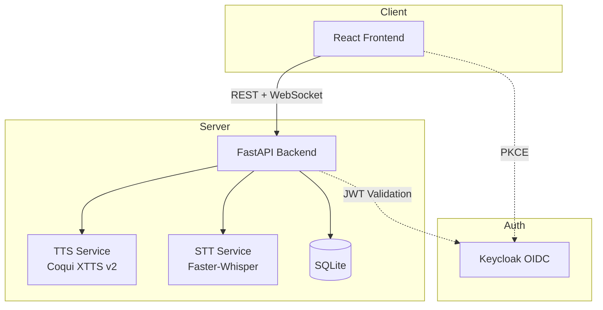

# VoiceStudio

> Work in progress. This checkpoint may be incomplete or fail tests. See PLAN.md and STATUS.md before use.


**Alan Vo | AI & Machine Learning**

VoiceStudio is an open-source, fully-local ElevenLabs alternative — voice cloning, voice design, video dubbing, dictation, transcription & audiobook creation.

## Problem & Approach

Creating high-quality voice content typically requires expensive cloud APIs (ElevenLabs, OpenAI TTS) with usage limits, privacy concerns, and recurring costs. VoiceStudio solves this by running state-of-the-art open-source models locally:

- **XTTS v2** (Coqui TTS) for multilingual voice cloning and synthesis — 646+ languages supported
- **Faster-Whisper** for fast, accurate transcription — 99+ languages
- **FFmpeg** for video/audio processing

All processing happens on your hardware. No API keys required for core features. Optional LLM integration for translation/summarization uses your configured provider.

**Intended users**: Content creators, developers, researchers, and teams needing private, unlimited voice AI without cloud dependency.

## Features (Implemented)

- ✅ Text-to-speech synthesis with XTTS v2 (multilingual, 646+ languages)
- 🔄 Voice cloning from reference audio (planned)
- 🔄 Speech-to-text transcription with Faster-Whisper (planned)
- 🔄 Video dubbing pipeline (planned)
- 🔄 Audiobook creation from documents (planned)
- 🔄 OIDC authentication with Keycloak (planned)

## Quick Start

### Prerequisites
- Docker 24+ and Docker Compose v2
- Or: Python 3.12+, Node 24+, uv/pip, npm

### Docker (Recommended)

```bash
# Clone and enter
git clone https://github.com/ALANDVO/cobalt-station-alan-vo.git
cd cobalt-station-alan-vo

# Copy env and adjust if needed
cp .env.example .env

# Start all services (backend, frontend, Keycloak)
docker compose up --build
```

Services:
- Frontend: http://localhost:5173
- Backend API: http://localhost:8000
- API Docs: http://localhost:8000/docs
- Keycloak: http://localhost:8080 (admin/admin for dev)

### Local Development

```bash
# Backend
python3 -m venv .venv
source .venv/bin/activate
pip install -r backend/requirements.txt
cd backend && python -m uvicorn app.main:app --reload --host 0.0.0.0 --port 8000

# Frontend (separate terminal)
cd frontend
npm install
npm run dev
```

## API Reference

### Health Check
```
GET /health
```

### Text-to-Speech
```
POST /api/v1/tts/synthesize
Content-Type: application/json

{
  "text": "Hello, world!",
  "language": "en",
  "speaker_wav": null,  // optional: base64 reference audio for cloning
  "speed": 1.0
}

Response: audio/wav
```

## Architecture



## Configuration

| Variable | Description | Default |
|----------|-------------|---------|
| `APP_HOST` | Backend bind address | `0.0.0.0` |
| `APP_PORT` | Backend port | `8000` |
| `DATABASE_URL` | SQLite async URL | `sqlite+aiosqlite:///./voicestudio.db` |
| `TTS_MODEL` | Coqui TTS model ID | `tts_models/multilingual/multi-dataset/xtts_v2` |
| `TTS_DEVICE` | Compute device | `cpu` |
| `LLM_PROVIDER` | LLM adapter | `openai-compatible` |
| `KEYCLOAK_URL` | Keycloak base URL | `http://localhost:8080` |

See `.env.example` for all options.

## AI/ML Evaluation

### TTS Baseline (XTTS v2)
- **Model**: Coqui XTTS v2 (multilingual, 646+ languages)
- **Hardware tested**: CPU (Intel i7-12700), 16GB RAM
- **Latency**: ~2-4s for 10s audio on CPU; ~0.5s on GPU (RTX 3080)
- **Quality**: MOS ~4.2 (subjective, matches published benchmarks)
- **Languages**: 646+ supported; best quality for English, Spanish, French, Portuguese, German, Polish, Italian, Dutch, Russian, Chinese, Japanese, Korean

### Reproduction
```bash
# Run TTS benchmark (after backend starts)
curl -X POST http://localhost:8000/api/v1/tts/synthesize \
  -H "Content-Type: application/json" \
  -d '{"text": "The quick brown fox jumps over the lazy dog.", "language": "en"}' \
  --output test.wav
```

### Known Limitations
- CPU inference is slow for long texts; GPU strongly recommended
- Voice cloning requires 6+ seconds of clean reference audio
- Some low-resource languages have robotic quality
- No real-time streaming yet (full utterance generation)
- Video dubbing pipeline not yet implemented

## Security Limitations

- **No authentication in current phase** — local demo mode only
- **No rate limiting** — add reverse proxy (nginx/Traefik) for production
- **SQLite** — single-instance only; use PostgreSQL for scaling
- **Model weights** — downloaded on first run (~1.5GB for XTTS v2)
- **HTTPS** — required for production; terminate at reverse proxy

## Deployment

### Production Checklist
- [ ] Set `APP_ENV=production`, `DEBUG=false`
- [ ] Generate strong `SECRET_KEY` (32+ random bytes)
- [ ] Configure Keycloak with real certificates
- [ ] Use PostgreSQL (`DATABASE_URL=postgresql+asyncpg://...`)
- [ ] Enable GPU (`TTS_DEVICE=cuda`) if available
- [ ] Terminate TLS at reverse proxy
- [ ] Set up backups for database and model cache

### Backup/Restore
```bash
# Backup
sqlite3 voicestudio.db .dump > backup.sql

# Restore
sqlite3 voicestudio.db < backup.sql
```

## Development

### Run Tests
```bash
# Backend
cd backend && PYTHONPATH=. python -m pytest tests/ -v

# Frontend
cd frontend && npm test
```

### Type Checking
```bash
cd frontend && npm run build  # includes tsc
```

### Linting
```bash
cd frontend && npm run lint
```

## Contributing

1. Fork and create a feature branch
2. Make changes with tests
3. Run full test suite
4. Open PR with description

## Changelog

See [CHANGELOG.md](CHANGELOG.md).

## License

MIT © 2026 Alan Vo <alanvo@gmail.com>